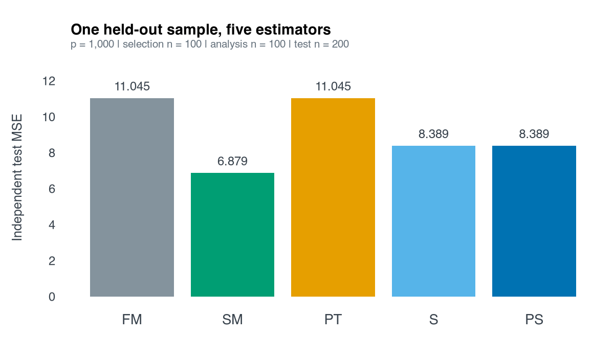

HDMaxShrink provides test-guided interpolation between full-model and
submodel coefficient estimates. The current workflow separates submodel
selection, estimation, and held-out evaluation.

## Install

Use R 4.1 or later, C++17 and the declared Rcpp/RcppArmadillo dependencies.

```{r installation, eval=FALSE}
remotes::install_github("byuzbasi/HDMaxShrink", upgrade = "never")
```

This is a GitHub research package. The associated methods record is the
[2026 arXiv preprint](https://arxiv.org/abs/2609.23070), not a journal publication.

## Follow the current example

The repository's [self-contained quick-start script](https://github.com/byuzbasi/HDMaxShrink/blob/main/inst/examples/quickstart.R)
generates independent selection, analysis and test samples. It uses CPSS-LASSO
for optional additions to a prespecified mandatory core, a joint Ridge full
model, and an exact-null SVD submodel. Run it deliberately after installation:

```{r example-command, eval=FALSE}
source(system.file("examples", "quickstart.R", package = "HDMaxShrink"))
```

The script uses 1,000 predictors, 20 complementary selection pairs and 199
conditional Gaussian draws. It is one synthetic illustration, not the paper's
production study. This guide displays the command without executing that
calibration during the website build.



This figure is retained from the repository's fixed-seed quick-start example;
it is not new benchmark evidence. Reproduce it with the linked script and
report the exact package version used.

## Choose a documented route

| Route | Entry point | Scope |
|:--|:--|:--|
| Current independent-selection route | `cpss_select_core()`, `fit_cpss_ridge_shrinkage()` | CPSS-selected exact-null submodel and all-predictor Ridge endpoint |
| Prespecified-core alternative | `fit_hd_shrinkage()` | Retained joint square-root-LASSO workflow |
| Historical sensitivity routes | `fit_partial_sqrt_lasso_shrinkage()`, `fit_ridge_mcp_shrinkage()` | Explicitly retained research modes, not silent replacements |
| Inspect estimates | `coef()`, `predict()` | Original-scale coefficients and predictions |

The [retained technical guide](HDMaxShrink.html) covers several frameworks;
its square-root-LASSO section is an alternative to the current CPSS/Ridge
route. Consult the function reference for the selected route rather than
mixing their arguments or inferential assumptions.

## Read diagnostics before interpreting shrinkage

Selection and analysis samples must be independent for the conditional
argument. A selected submodel is not necessarily a true null. Inspect rank,
test calibration and convergence information, and keep held-out data out of
selection. Classical James–Stein dominance is not asserted. The optional
CPSS-MCP sensitivity requires the declared `grpreg` dependency.

See [data and reproduction](data-and-reproduction.html) for input roles,
source provenance, version reporting and validation boundaries.
